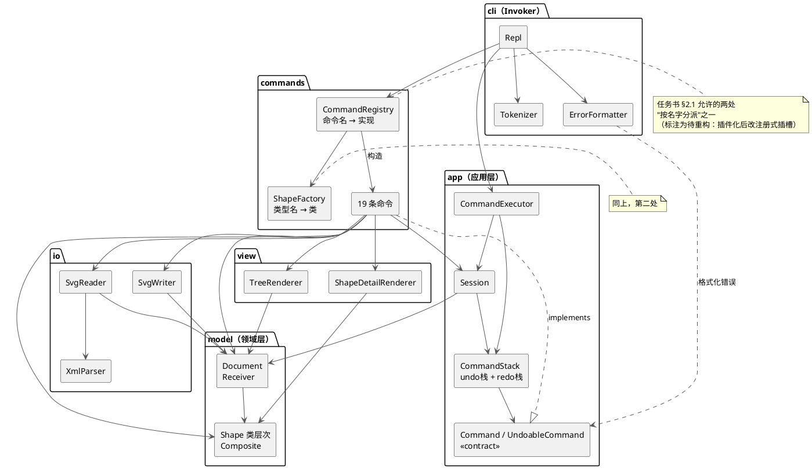
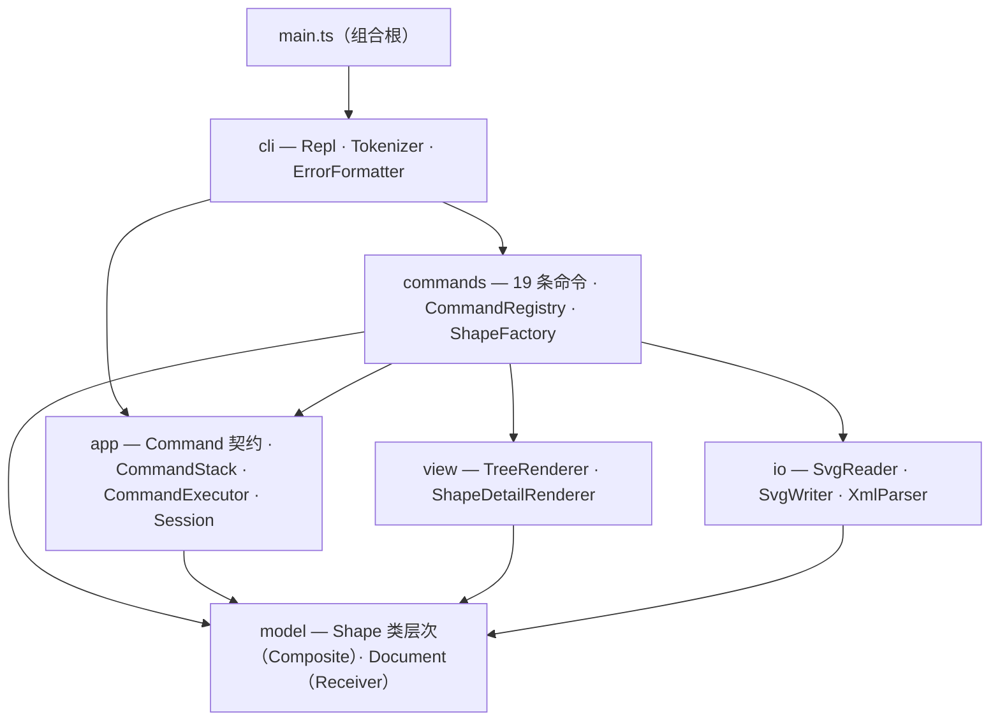

# PJ1 · CLI SVG 编辑器 — 设计文档

> 本文档按任务书 §1.2 要求组织，共四个部分：架构方案、过程记录、一致性自查、质量保证手段。
> 状态：**骨架已建立，内容随各阶段推进逐步补全。**

---

## 一、架构方案

### 1. 模块划分

六个模块 + 一个组合根，按"依赖只向稳定方向流动"排列：

| 模块 | 文件 | 行数 | 职责 | 不允许做的事 |
|---|:-:|:-:|---|---|
| `src/cli/` | 3 | 185 | REPL 循环、分词、错误格式化、控制台输入输出 | 直接修改图形数据 |
| `src/app/` | 9 | 244 | 应用层：`Command` / `UndoableCommand` 契约、命令栈、执行器、会话状态 | 依赖具体命令实现、做文本渲染 |
| `src/commands/` | 22 | 1264 | 19 条命令的具体实现、命令注册表、图形工厂 | 包含业务逻辑（应只做校验与转发） |
| `src/view/` | 2 | 76 | 把文档/图形渲染成给人看的文本（`tree` / `show`） | 修改图形数据 |
| `src/model/` | 19 | 1150 | 图形类层次（Composite）、文档模型（Receiver）、领域错误 | 打印、读写文件、认识上层 |
| `src/io/` | 6 | 541 | SVG 读写、XML 解析 | 修改内存中的文档结构 |
| `src/main.ts` | 1 | 9 | 组合根：装配 `Repl` 并启动 | 承载业务逻辑 |

> 文件数/行数由 `npm run check:arch` 自动统计：共 62 个 TS 文件、3469 行。

**组件图（PlantUML）**：



（该图是 PlantUML 源码，可直接粘贴到 plantuml.com 或 IDE 插件渲染。）

**同一套结构的 Mermaid 版本**（GitHub / VS Code 可直接渲染，方便快速查看）：



### 2. 设计模式的选择

#### Command（行为型）—— 满足任务书 §1.2 的强制要求

- **问题**：编辑器需要 undo/redo。撤销意味着"动作"必须能被**保存下来并重新调用**，而一行 `shape.x += dx` 存不下来。
- **方案**：把请求封装成对象。`UndoableCommand` 声明 `execute()` 与 `undo()`，`CommandStack` 用两个栈管理它们。
- **落地点**：`src/app/Command.ts`、`UndoableCommand.ts`、`CommandStack.ts`、`CommandExecutor.ts`；每条命令一个类（`src/commands/*Command.ts`）。
- **角色对应**（对应课件命令模式 p16-17）：

  | GoF 角色 | 本项目 |
  |---|---|
  | `Command` | `src/app/Command.ts`（`execute(): string[]`） |
  | `ConcreteCommand` | `CreateCommand` / `MoveCommand` / … 共 10 个可撤销命令 |
  | `Invoker` | `Repl` + `CommandExecutor`（持有并触发） |
  | `Client` | `CommandRegistry`（造出命令并设置接收者） |
  | `Receiver` | `Document` / `Shape`（真正改数据的地方） |

- **为什么它能解决问题**：命令出栈之后**仍然可以被调用**——这是"请求成为对象"才有的能力（课件 p14）。

#### Composite（结构型）—— 满足 §2.1「容器与叶子统一操作」

- **问题**：`<g>` 是容器，`<rect>` 是叶子。如果每条命令都区分两者，就会出现 `switch(tag)` 或 `instanceof` 分支，且新增图形类型要改所有命令。
- **方案**：`Group` 也继承 `Shape`。`moveBy` / `scaleBy` 在叶子上改自身坐标，在容器上**递归转发**给子节点。调用方只写 `shape.moveBy(dx, dy)`，不知道拿到的是哪一种。
- **落地点**：`src/model/Shape.ts` 的抽象方法 + `src/model/Group.ts`。
- **实证**：`move node2 0 100` 一条命令让整个节点（矩形 + 文字）一起动（见过程记录 P4）。

#### 明确**不用**的模式（以及理由）

| 模式 | 为什么不用 |
|---|---|
| Iterator | `tree` 递归遍历已经够；课件迭代器 p18 明确"简单稳定的结构没必要模式化，避免过度设计" |
| Memento | Command 模式已经解决了 undo；再叠一层备忘录会让"每条命令记什么"变模糊 |
| Visitor | 本项目的"操作增加"不频繁（只有 tree/show/save 三处），用 `Shape` 的多态方法即可；Visitor 适合"元素稳定、操作多变" |

这两处"不用"同样是设计判断，写在这里是为了说明：**模式不是越多越好**。

### 3. 依赖方向规则

**规则**（`npm run check:arch` 会逐条校验）：

```text
cli      →  app, commands
commands →  app, model, view, io
app      →  model
view     →  model
io       →  model
model    →  （不依赖任何模块）
src/main.ts 是组合根，允许依赖任意模块
```

**为什么这样定**：

- `model` 是领域核心，必须**零依赖**——它不知道 CLI、文件、渲染的存在。因此它最稳定、最容易测（接收者层的 30 个测试完全不碰上层）。
- `app` 只依赖 `model`：命令契约与命令栈属于应用层，不该认识具体命令实现。这样**新增命令不需要改命令栈**。
- `commands` 依赖 `app`（契约、Session）、`model`（Receiver）、`view`（tree/show 渲染）、`io`（read/save）。它是协作最密集的一层。
- `cli` 只依赖 `app` 与 `commands`：它负责输入输出，不该认识图形。
- 渲染器放 `view/` 而不是 `cli/`，正是为了让 `commands` 不必反向依赖 `cli`。

**检查方式不是靠自觉，而是实证**：

```powershell
npm run check:arch
```

脚本扫描 `src/` 下真实 import、按模块聚合，输出边表并对照白名单；出现表外依赖以退出码 1 结束，可挂进提交流程。

### 4. 变化点假设

逐条列出"我认为未来最可能变化的地方"，以及为它留了什么——**或者为什么决定不留**。

| # | 变化点 | 为它留了什么 | 或者为什么决定不留 |
|:-:|---|---|---|
| 1 | **新增命令**（如 copy / paste / align） | `UndoableCommand` 插槽：新增一个类 + 注册表一行；命令栈零改动 | — |
| 2 | **新增图形类型**（如 box / path） | `ShapeFactory` 插槽：一个 `Shape` 子类 + 工厂注册 | 不做插件化：§2.1 允许本阶段架构层"无插槽"，`box` 按 §4.4 属下一阶段，提前抽象反而猜错方向 |
| 3 | **图形渲染格式变化**（样式、transform） | `Shape.toSvg()` 是唯一出口，改动收敛在各子类内部 | `transform` 目前只保留、不应用；这是**已知限制**，不是预留 |
| 4 | **tree / show 的显示格式** | 集中在 `view/` 两个渲染器，命令层完全不感知 | — |
| 5 | **撤销粒度改为事务 / 宏** | `CommandStack` 是唯一入口；宏命令只需实现 `UndoableCommand` 并组合子命令 | — |
| 6 | **持久化格式扩展**（defs、CSS、多文件） | `io/` 完全隔离，扩展读写不影响内核 | 未支持 `defs` / CDATA / DTD，边界已在 `XmlParser` 注释中写明 |
| 7 | **命令分发改为插件注册** | `CommandRegistry` 已是唯一集中处，并标注为"待重构项" | 本阶段只允许两处按名字分派（§2.1），不额外抽象 |
| 8 | **多文档 / 多视图** | `Session` 是唯一持有"当前文档"的地方 | 单文档已满足 §3 全部命令，提前引入只会增加状态管理复杂度 |

**结论**：变化点 1、5、7 是零成本扩展（加类 + 注册）；2、4、6 是低成本（改动被模块边界关住）；3 是已知缺口，如实记录。

---

## 二、过程记录

> 记录关键、有代表性的讨论与迭代：从 AI 给出的建议/代码中发现了什么问题、如何确认并纠正。

### 阶段 P0：工程骨架

- 建了 TypeScript 工程（`tsc` 编译、`tsx` 直跑、Vitest 测试），`src/cli/` 下先落地 `Repl` 与 `Tokenizer` 两类。
- 遇到的问题与纠正：`exit` 命令后仍执行 `rl.prompt()`，抛出 `ERR_USE_AFTER_CLOSE`；改为在关闭后不再 prompt（`stopped` 标志）。这说明"逐个命令的边界条件"要在骨架期就想清楚。

---

### 阶段 P1：图形数据模型

- 用抽象基类 `Shape` + 六个子类落地「多态替代 switch」（对应 OOP 回顾 p28-32 的正例：`Canvas` 只依赖 `Shape.draw()`）。上层命令只面向 `Shape` 调用，以后新增图形类型不需要改任何命令。
- **设计判断 1（任务书存在规格歧义）**：§6.1 中 `line` 以 `stroke=black` 创建，但 `tree` 输出只显示 `(280,130) -> (520,130)`，不含 stroke。据此确定规则：**tree 只内联 `fill`**，`stroke` / `stroke-width` 收进 `show` 明细——依据是 §5.2 的 `show` 才展示完整属性。这个取舍写进了 `Shape.attributeSummary()` 的注释。
- **设计判断 2**：`Group` 也继承 `Shape`。`moveBy` / `scaleBy` 在叶子上是"改自己的坐标"，在容器上是"递归转发给每个子节点"——**同一个方法签名、两种实现**，这是 Composite 的最小形态。
- **设计判断 3**：把 `clone()` 做成模板方法（基类管属性复制、子类只管几何），为 P5 的 undo 方案预先留好深拷贝能力。
- **被测试抓到的问题**：`attributeSummary()` 用两个空格拼接几何与 `fill`，产出 `h=600  fill=#ffffff`，与任务书 §5.1 的单空格格式不一致。这是断言精确字符串的单元测试暴露的，改为单空格后通过。说明"看起来对"和"逐字对上规格"是两件事。
- 本阶段产出 23 个单元测试，覆盖 SVG 渲染、tree 摘要、move/scale、set 白名单、clone 深拷贝、父子指针维护。

---

### 阶段 P2：文档模型与只读命令

- 引入 `Document` 作为命令模式里的 **Receiver**：持有画布尺寸、根级图形列表、`id → 图形` 索引。命令只调它的方法，不直接碰数据结构——对应命令模式 p17「命令只做转发，业务逻辑属于接收者」。
- **设计判断 1（依赖方向）**：一开始把 `TreeRenderer` 放在 `src/cli/` 下，随即发现 `TreeCommand` 会反过来依赖 `cli`，形成**反向依赖**。于是新增 `src/view/` 模块承载文本渲染，依赖变成 `cli → commands → view → model`，命令层不再认识 cli。
- **设计判断 2（规格不完整时怎么办）**：任务书 §5.1 的树形示例里各列宽并不一致（外层约 15 列、内层约 11 列），反推不出唯一对齐规则。决定取"**同一组兄弟按最宽 label + 2 空格对齐**"，并用单元测试把输出逐字锁住。宁可定一条可复现规则，也不要让输出随 label 长度抖动。
- **设计判断 3（按名字分派的边界）**：`CommandRegistry` 是任务书 §2.1 允许的两处"按名字分派"之一（命令分发）。已在类注释里标注它属于**待重构项**——插件化阶段应改为注册式插槽，而不是内核写死。
- **AI 产出被工具打回**：`CommandRegistry` 里留了一个未使用的 `Session` import，被 `tsc --noEmit`（`noUnusedLocals`）当场拦下。说明"类型检查必须进提交前检查清单"，不能只靠跑测试。
- 累计 48 个单元测试（P1 的 23 + 本阶段 25），覆盖 Document 索引与重复 id、tree/show 逐字对齐、命令参数校验与 §4.2 错误文案。

---

### 阶段 P3：create 命令与图形工厂

- `ShapeFactory` 承担任务书 §2.1 允许的**第二处、也是最后一处**按名字分派（图形工厂：类型名 → 类）。类注释里已标注为**待重构项**：插件化阶段应改为 `ShapeProvider` 注册表，内核不再认识具体类型。至此两处配额用尽，代码里不应再出现第三处 `switch(name)`。
- **真实 bug（由测试抓到，值得记录）**：分词器一开始把**行内** `#` 当注释，导致 `create rect start 120 100 160 60 #4a90d9 in node1` 里的颜色值 `#4a90d9` 连同后面的 `in node1` 一起被吞掉，图形挂到了画布根而不是容器。回查任务书 §2 原文是「`#` **开头**为注释」——指**整行注释**，不是行内注释。改为"行首注释、行内 `#` 原样保留"，并补 7 个分词器单元测试把这条语义锁住（含颜色值、引号内 `#`、空行）。
- **设计判断 1（`in` 子句的判定方式）**：用"**倒数第二个 token 等于 `in`**"来识别尾缀，而不是"包含 in"。否则 `create text t1 0 0 "in"`（内容恰好是 in）会被误判成容器子句。专门写了两个测试覆盖这个歧义：内容为 `in` 但无子句、内容为 `in` 且真的带子句。
- **设计判断 2（先校验后修改）**：`create` 先校验容器存在且确实是 `<g>`，再交给工厂造图形，最后才 `document.add`。因此失败的 create 不会留下半个图形——测试「失败的 create 不留下任何图形」验证了这一点。这条与 §4.2「命令失败不改变任何状态」同源。
- 测试从 48 个增加到 **71 个**。新增覆盖：六种类型的创建与回显、可选 fill/stroke、`in` 嵌套、重复 id、未知类型（含 §4.2 的插件提示文案）、容器不存在 / 不是容器、参数个数、未 init。

---

### 阶段 P4：编辑命令与 Composite 统一操作

- `move` / `scale` / `set` / `delete` 四条命令**不包含任何业务逻辑**：移动是 `shape.moveBy()`、缩放是 `shape.scaleBy()`、删除是 `document.remove()`。命令只做参数校验 + 转发（命令模式 p17、p20）。
- **Composite 第一次真正落地**：同一条 `move node1 0 100`，对叶子是"改自己的坐标"，对容器是"递归转发给每个子孙"。调用方 `MoveCommand` 完全不知道自己拿到的是哪一种——这就是任务书 §2.1「容器与叶子统一操作」的可运行证据。
- **设计判断 1（从示例反推反馈格式）**：任务书里 `move` 有两种回显——§6 的叶子是 `circle#c1 moved to (130,100)`（绝对坐标），§6.1 的容器是 `g#node2 moved by (0,100)`（位移量）。据此在 `Shape` 上新增 `referencePoint()`：叶子返回参照点（rect 左上角、circle 圆心等），容器返回 `null` 并触发 `moved by`。规格只给了样例、没给规则时，就按样例反推出一个能同时满足两者的抽象。
- **设计判断 2（为 undo 预留结构）**：`Document.remove()` 不返回删除的图形本身，而是返回 `{ shape, parent, index }`。原因是 P5 的 undo 必须把图形放回**原父容器的原下标**，否则兄弟顺序变化会让 z-order 错乱。结构提前定好，P5 就不用返工。
- **设计判断 3（校验先于变形）**：`scale` 的因子校验在调用 `scaleBy` 之前；`scale r1 0` 抛 `scale factor must be positive`（§4.2）后，几何保持不变——测试里专门断言了这一点。
- 测试 71 → **89 个**。

---

### 阶段 P5：undo/redo —— 先快照法，再重构为 Command 模式

这一段是本项目最关键的一次迭代，**故意先做"能跑但不好"的版本**，量出代价后再重构。

#### 第一版：快照法（已弃用，保留在 git 历史 `9758092`）

- 做法：每次编辑命令执行前 `document.clone()` 存整份文档；`undo` 直接换回上一个快照。
- 优点：十几分钟就能跑通，98 个测试通过。
- **实测代价**（100 / 1000 / 5000 个图形，Python 计时 200 次取平均）：

  | 图形数 | 每次编辑的快照耗时 | 克隆对象数 |
  |---:|---:|---:|
  | 100 | 0.026 ms | 101 |
  | 1000 | 0.122 ms | 1001 |
  | 5000 | 0.794 ms | 5001 |

- **致命缺陷不是慢，而是"语义丢失"**：快照法只知道"整份文档变回了某个样子"，**不知道是哪条命令被撤销**。而任务书 §6 明确要求：

  ```text
  svg> undo
  circle#c1 moved back to (100,100)
  ```

  快照法根本生成不出这句话。这与课件**命令模式 p21** 的提醒完全一致：「AI 可能直接给你"每次操作前存整个文档快照"的方案。要在提示词里说清要哪一种，并把判据交给 AI。」——**判据就是：撤销反馈要不要落到具体命令上。**

#### 第二版：Command 模式（当前实现）

- `UndoableCommand extends Command`：在 `execute()` 之外增加 `undo()`。只有编辑类命令实现它——显示类、文档类不该被塞进撤销栈（§4.3）。
- `CommandStack`：两个栈，行为逐条对齐课件 **命令模式 p22-25**
  - 执行：`push(cmd)` → `execute()` → **清空 redo 栈**
  - 撤销：`pop()` 出最近一条 → `undo()` → 转入 redo 栈
  - 重做：从 redo 栈 `pop()` → 重新 `execute()` → 放回 undo 栈
  - 文档类命令后：清空两栈并置 `ioBlocked`，`undo`/`redo` 报 `undo not allowed after io command`，直到下一次编辑命令解禁
- **每条命令记什么（这是设计的核心成本）**：

  | 命令 | 记住什么 | 为什么 |
  |---|---|---|
  | `create` | 创建出的图形对象引用 | 撤销 = 按 id 删掉它 |
  | `delete` | `{ shape, parent, index }` | 必须放回**原父容器的原下标**，否则兄弟顺序变了、z-order 就错 |
  | `move` / `scale` | `GeometrySnapshot`（被改动那棵子树的几何值） | 见下 |
  | `set` | 旧值 + "原本是否存在该属性" | 原本没有 `fill` 时，撤销要整个删掉，而不是设成空串 |

- **为什么不写"反向运算"（`moveBy(-dx,-dy)` / `scaleBy(1/f)`）**：浮点运算不保证可逆，`10 × 3 ÷ 3` 可能得到 `9.999999999999998`。因此 `GeometrySnapshot` 只记录**几何属性值**，撤销时把旧值写回原对象（对象身份不变，其它引用仍有效）。
- **量化对比**（同一次"移动一个叶子图形"）：

  | 图形数 | 快照法 | Command 法 | 加速比 |
  |---:|---:|---:|---:|
  | 1000 | 0.156 ms（克隆 1001 个对象） | 0.0039 ms（记 1 个节点） | 40× |
  | 5000 | 0.651 ms（克隆 5001 个对象） | 0.0006 ms（记 1 个节点） | 1124× |

  差距来源很直接：**快照法的代价与整份文档规模成正比，命令的代价只与"这条命令改动了多少"成正比。**

- 测试 98 → **109 个**，新增覆盖：四种命令的 undo 反馈文案、LIFO 顺序、redo 栈清空、io 命令前后 undo/redo 的禁止与解禁、scale 撤销的精确性。

---

### 阶段 P6：容器命令与"移动"的语义

`group` / `ungroup` / `addto` / `front` / `back` 的功能不难，难的是**三条容易把树改坏的地方**。

- **难点 1：防环。** `group bad c1 markers`（markers 已经包含 c1）如果不拦，会造出"自己包含自己"的树，`tree` 命令会直接无限递归爆栈。校验放在**任何改动之前**，错误文案对齐 §4.2/§6：
  ```
  error: cannot group a container into its own descendant: markers
  ```
  `addto` 同样要拦"把容器挪进自己的后代"。

- **难点 2（本阶段最大的设计修正）："新建"和"移动"是两件事。**
  一开始只给 `Document` 提供了 `add` / `insert` / `remove`，它们都会**登记或注销 id 索引**。结果写 `ungroup` 的 undo 时报 `id already exists`：因为被提升到父级的子节点**一直还在索引里**，再 `insert` 一次就重复登记了。
  修正：把 `Document` 的操作分成两套——
  - `add` / `insert` / `remove`：改**索引 + 结构**，用于新建 / 删除
  - `detach` / `reparent`：**只改结构**，用于移动（id 不变）
  这也顺带解释了为什么"移动一个图形"和"复制一个图形"在实现上是完全不同的两件事。

- **难点 3：undo 必须"原位恢复"。** 容器命令改变的往往是**兄弟顺序**：
  - `group` 的 undo 要按**原下标升序**放回（降序插会把顺序插反）
  - `front` / `back` 的 undo 要恢复原下标
  - `delete` 的 undo 要回到原父容器的原下标（这一步在 P4 就预留了 `{shape, parent, index}`）
  兄弟顺序不是"无所谓"的细节——它就是 z-order，`front`/`back` 的全部意义所在。

- **规格取舍**：§4.2 规定画布根级容器**不允许** `ungroup`（`cannot ungroup top-level container`）。这意味着 §6.1 那个根级的 `g#flowchart` 实际上解不开。照规格实现，并在这里记一笔。

- 测试 109 → **128 个**。新增覆盖：收入顺序与落位、防环（group 与 addto）、索引语义（移动不重复登记）、四条命令的 undo 原位恢复、z-order 只在同级生效。

---

### 阶段 P7：SVG 读写与自动补 id

到这一步程序才真正"能存文件、能用浏览器打开看图"。

- **自己写 XML 解析器（`src/io/XmlParser.ts`）而不引第三方库**：理由有两层——依赖越少，构建与提交越可控；而 SVG 需要的语法子集（声明、注释、自闭合、嵌套、单双引号属性、文本、常用实体）量级完全可控，不需要通用 XML 库。代价是不支持 CDATA 与 DTD 实体定义，已在代码注释里写明边界。

- **设计判断 1：自动补 id 必须两遍扫描。**
  如果边解析边分配，会出现"先给匿名 `<rect>` 分配了 `rect1`，后面却读到一个显式 `id="rect1"`"的撞车。因此：
  1. 第一遍收集文件里**所有显式 id**；
  2. 第二遍按文档顺序，为没有 id 的元素分配 `标签名+序号`，跳过所有已声明/已分配的 id。
  一条警告一次分配，文案对齐 §6：`warning: assigned id rect1 to unnamed <rect>`。

- **设计判断 2：未知属性原样保留。**
  内核只解析几何属性与 `fill`/`stroke`/`stroke-width`，其余（`font-size`、`text-anchor`、`transform`、`data-*`…）通过 `restoreAttribute` 原样收着，`save` 时不丢。这样"读一个带字号的 SVG、改个坐标、再存回去"不会把字号抹掉。
  **已知限制**：`transform` 只被保留、不被应用——如果我们对一个带 `transform` 的 `<g>` 做 `move`，会得到"transform + 新坐标"的叠加效果。本阶段不处理，已记入「变化点假设」。

- **设计判断 3：为什么文档类命令必须禁用 undo。**
  不只是"任务书 §4.3 这么写"。真实原因是：`read` 会把当前文档整个换掉，如果还能 undo，就可能把**另一份文档**的编辑历史搬过来，导致撤销后 document 与 sourcePath 不一致。禁用 undo + 清空历史，是保证"当前文档 ↔ 当前文件"始终对齐的最简做法。

- **设计判断 4：`save` 无参数时写回 `read` 的路径，并在保存后更新当前路径。** 这样"改一点 → 存"的循环不用反复敲路径；同时保存到新路径后，后续无参数 `save` 自然跟随。

- 新增 `examples/other.svg`（任务书 §6 的示例输入）与 `examples/flowchart.svg`（CLI 生成的真实输出），可直接用浏览器打开验证。
- 测试 128 → **154 个**。新增覆盖：XML 子集解析、自动补 id 与撞车规避、viewBox 回退、实体解码、未知标签忽略、未知属性保留、`save`→`read` round-trip 等价、读写失败的错误文案、io 后 undo 禁止。

---

### 阶段 P8：错误文案逐条对齐 §4.2

功能已经齐了，这一阶段做的是**验收密度**：把任务书 §4.2 表格里的每一条都变成一条可执行断言。

- 抽出 `ErrorFormatter`：Repl 打印错误和测试断言错误必须走**同一条**格式化路径。否则很容易出现"测试断言 message、线上打印 `error: message`"的错位。
- `test/commands/error-messages.test.ts` 用一张对照表覆盖 §4.2 全部条目，**期望值带 `error: ` 前缀**（即用户真正看到的那一行）。
- 除了文案，每条失败命令还额外验证两件事：
  1. **失败不改变任何状态**——执行前后 `tree` 必须完全一致；
  2. **失败不污染撤销栈**——连续制造 4 条失败命令后，`undo` 只撤销那一条真正成功的 `create`。
- **一处诚实的空缺**：§4.2 的 `cannot ungroup composite shape: n1` 在本阶段**不可达**。因为 §4.4 明确 `box` 属于后续插件化阶段，本阶段 `create box` 会先报 `unknown shape type`。测试里专门写了一条用例把这个事实固定下来，等插件化阶段再启用该分支。

---

### 阶段 P9：测试分层与覆盖矩阵

前面的测试是"写到哪测到哪"，这一阶段按 **TDD 课件 p33** 的四层策略重新盘点，补上最薄的两层。

- **盘点结果：端到端层和调用者层几乎是空的。**
  - 端到端：此前没有一条测试真正经过 `Repl`，所有命令测试都绕过它直接调执行器。也就是说"提示符、错误打印、退出行为"从没被自动验证过。
  - 调用者层：`CommandStack` 只在命令测试里被间接覆盖，栈自身的编排顺序没有独立测试。

- **改造点：让 `Repl` 可测。** 它原先硬编码 `process.stdin` 与 `console.log`，完全不可注入。改为构造参数接收 `input`/`output` 流、内部统一走 `print()`、`start()` 返回 `Promise<void>`（输入结束即 resolve）。这样端到端测试可以用内存流跑出确定结果，不用起真实终端。
  这正是 TDD 课件 p14 说的「可测试的两个条件：控制输入、观测输出」——**不可测往往不是测试的问题，是设计的问题。**

- **调用者层用"假命令"测。** `test/app/command-stack.test.ts` 里的 `FakeCommand` 只往日志数组里记一笔，不碰任何真实图形。于是"执行顺序、入栈出栈、redo 清空、io 后禁止"这些**编排行为**能被单独断言——对应课件 p33「用 mock 命令验证『谁被调用、顺序如何』」。

- **新增命令覆盖矩阵测试**：断言注册表**恰好**等于 §3 的 19 条命令（不缺、不多），并逐条检查 `kind` 分类。以后谁新增命令却忘了分类，这条会先红。

- **一条踩过的坑：会"过期"的断言。** P2 时写过 `expect(registry.get('create')).toBeUndefined()`，到 P3 实现 create 后就红了。教训是：**断言要表达稳定的契约，不要表达"当前进度"**。改成断言一个永不会注册的假名字。

- 测试 168 → **207 个**（接收者层 30 / 命令层 110 / 调用者层 9 / 端到端 8 / 支撑层 28 / 规格一致性 22）。

---

### 阶段 P10：文档定稿与"可复验的架构"

这一阶段做的不只是把文档写满，还真的**验了一遍架构**。

- **用脚本做依赖审计，抓到一处真违规。** 扫描 `src/` 下真实 import 后，第一次的结果是：
  ```
  app -> commands     2 处   ← 与下面的边构成循环
  commands -> app    29 处
  ```
  `app/CommandExecutor.ts` 与 `app/UndoableCommand.ts` 引用了 `commands/Command.ts` 里的命令契约。虽然都是 `import type`（编译后擦除，运行时没出过 bug），但它意味着"改 `commands` 会牵动 `app`"，与方案里写的单向依赖不符。
  **修复**：把 `Command` / `CommandKind` 连同 `UndoableCommand` 归到应用层 `src/app/`，`commands` 改为从 `app` 取契约。命令契约本来就属于"应用层定义、命令层实现"，这个移动也让分层更顺。

- **把检查固化成工具**：`scripts/check-architecture.mjs` + `npm run check:arch`。它输出模块规模与依赖边表、对照白名单、违规即退出码 1。
  **为什么要固化成脚本**：架构规则写在文档里只是承诺，写成可执行检查才是约束。以后任何人（包括我自己）加了一条约外的 import，跑一次就知道。

- **文档定稿的四节**：模块划分（含文件数/行数与两张图）、设计模式的选择（含**明确不用的模式**及理由）、依赖方向规则、变化点假设（8 条，逐条写清"留了什么"或"为什么不留"）。

- **`一致性自查` 如实写"曾经违反过"**，而不是粉饰成"完全一致"。理由很直接：自查的价值在于发现偏差，不是证明没偏差。

---

## 三、一致性自查

实现完成后，对照上面的方案如实回答两个问题。

### 1. 模块划分：实际目录与方案是否一致？

**一致。** 六个模块目录（`cli` / `app` / `commands` / `view` / `model` / `io`）及组合根 `main.ts` 都在，职责与表中描述吻合，没有遗留的临时目录或散落文件。

**有一处修订**：`Command.ts` 原本放在 `src/commands/`，P10 自查时上移到 `src/app/`。原因见下一条。该修订已写入本文档「过程记录 · 阶段 P10」。

### 2. 依赖方向：方案里的规则有没有被违反？

**曾经违反过，已修复。**

P10 用脚本扫描 `src/` 下真实 import，第一次运行的结果是：

```
app -> commands   2 处      ← 违规
commands -> app  29 处
```

`app` 里的 `CommandExecutor` 与 `UndoableCommand` 引用了 `commands/Command.ts` 里的命令契约，与 `commands → app` 构成**模块级循环依赖**，与"单向依赖"的方案不符。

**处理**：把命令契约（`Command` / `CommandKind`）与 `UndoableCommand` 一并归到应用层 `src/app/`，`commands` 改为从 `app` 取契约。修复后：

```text
$ npm run check:arch
...
依赖方向检查通过：无表外依赖。
```

**补充说明**：这 2 处 import 都是 `import type`，编译后会被擦除，**运行时并没有出过 bug**。但类型层面的循环会掩盖真实耦合——它让人以为模块是单向的，实际上改 `commands/Command.ts` 会牵动 `app`。这类问题正是"一致性自查"该抓的。

**现在这条规则是可复验的**，不是口号：`npm run check:arch` 已进入提交前检查清单（typecheck → test → check:arch → build）。

---

## 四、质量保证手段

### 1. 测试分层（按 TDD 课件 p33 的四层策略）

| 层 | 测什么 | 手段 | 文件 | 数量 |
|:-:|---|---|---|:-:|
| **接收者层** | 业务动作本身（图形几何、文档索引），不涉及命令框架 | 纯单元测试，直接 `new` 对象断言 | `test/model/shapes`、`test/model/document` | 30 |
| **命令层** | 每条命令执行后的状态变化、undo 是否精确还原、错误文案 | 直接构造命令 + 真实 Receiver（走注册表与执行器） | `test/commands/*` | 110 |
| **调用者层** | 命令栈的编排：调用顺序、入栈/出栈、redo 清空、io 禁止 | **假命令对象**替代真实 Receiver，只验编排 | `test/app/command-stack` | 9 |
| **端到端** | 一条真实操作链（输入 → 分词 → 分派 → 执行 → 打印） | 注入内存流替换 stdio，跑真实 `Repl` | `test/cli/repl` | 8 |
| 支撑层（不属于四层） | 分词、文本渲染、XML 解析与序列化 | 单元测试 | `test/cli/tokenizer`、`test/view/renderers`、`test/io/svg` | 28 |
| 规格一致性 | 注册表是否**恰好**包含 §3 的全部命令、分类是否正确 | 表驱动断言 | `test/commands/coverage` | 22 |

**合计 207 个测试，`npm test` 全绿。**

层与层的分工很明确：命令层出错时先看接受者层是否正常（缩小范围），端到端只覆盖"链路通不通"，不重复验证业务细节——否则一处改动要改三个地方。

> 端到端能测的前提是 `Repl` 的输入输出可注入：这正是 TDD 课件 p14「可测试的两个条件：控制输入、观测输出」。改造前它硬编码 `process.stdin` + `console.log`，只能人工敲。

### 2. 命令 × 能力覆盖矩阵

| 命令 | 正常路径 | 错误路径 | undo/redo | 备注 |
|---|:-:|:-:|:-:|---|
| `init` | ✅ | ✅ 参数个数 / 非数字 | — | 文档类，执行后禁用 undo |
| `read` | ✅ | ✅ 文件不存在 / 参数 | — | 自动补 id 并警告 |
| `save` | ✅ | ✅ 不可写 / 无路径 / 参数 | — | 无参数回退到 read 的路径 |
| `canvas` | ✅ | ✅ 参数个数 / 未 init | — | 只查询不改变历史 |
| `create` | ✅ | ✅ 重复 id / 未知类型 / 容器不存在 / 不是容器 | ✅ | 撤销 = `creation undone` |
| `delete` | ✅ | ✅ 不存在 / 参数 | ✅ | 撤销 = 原位恢复（parent+index） |
| `move` | ✅ | ✅ 不存在 / 参数 | ✅ | 撤销 = `moved back to/by` |
| `scale` | ✅ | ✅ 非正数 / 不存在 | ✅ | 撤销 = 精确还原几何（不做反向乘） |
| `set` | ✅ | ✅ 未知属性 / 不存在 | ✅ | 撤销 = 恢复旧值或删除属性 |
| `group` | ✅ | ✅ 防环 / 重复 gid / 参数不足 | ✅ | 撤销 = 各图形原位还原 |
| `ungroup` | ✅ | ✅ 根级容器 / 不是容器 | ✅ | 撤销 = 重新组装容器 |
| `addto` | ✅ | ✅ 不是容器 / 防环 | ✅ | 撤销 = 放回原位 |
| `front` | ✅ | ✅ 参数个数 | ✅ | 撤销 = 恢复原下标 |
| `back` | ✅ | ✅ 参数个数 | ✅ | 撤销 = 恢复原下标 |
| `tree` | ✅ | ✅ 未 init / id 不存在 | — | 显示类，不进栈 |
| `show` | ✅ | ✅ 未 init / id 不存在 | — | 显示类，不进栈 |
| `help` | ✅ | — | — | 显示类，不进栈 |
| `undo` | ✅ | ✅ 空栈 / io 后禁止 | — | 自身不进栈 |
| `redo` | ✅ | ✅ 空栈 / io 后禁止 | — | 自身不进栈 |

**19 条命令全部有正常路径测试；10 条编辑类命令全部有 undo 测试。**

### 3. §4.2 错误文案对照（由测试逐条锁定）

| # | 场景 | CLI 输出 | 测试 |
|:-:|---|---|:-:|
| 1 | id 已存在 | `error: id already exists: r1` | ✅ |
| 2 | id 不存在 | `error: no such shape: r9` | ✅ |
| 3 | `in` 目标不存在 | `error: no such container: node9` | ✅ |
| 4 | `in` 目标不是容器 | `error: not a container: start` | ✅ |
| 5 | 未注册的图形类型 | `error: unknown shape type: hexagon (is the plugin loaded?)` | ✅ |
| 6 | ungroup 复合图形 | `error: cannot ungroup composite shape: n1` | ⚠️ 本阶段不可达（`box` 属插件化阶段，见 §4.4） |
| 7 | group 含容器与其子孙 | `error: cannot group a container into its own descendant: markers` | ✅ |
| 8 | ungroup 根级容器 | `error: cannot ungroup top-level container: scene` | ✅ |
| 9 | scale 非正数 | `error: scale factor must be positive` | ✅ |
| 10 | 文件不存在 | `error: cannot read file: no-such-file.svg` | ✅ |
| 11 | 文件不可写 | `error: cannot write file: <path>` | ✅ |
| 12 | 未 read/init 就执行 | `error: no document. use 'init' or 'read' first` | ✅ |

覆盖率：**12 条中 11 条已覆盖，第 6 条按规格属于后续阶段**。

### 4. 怎么跑

```powershell
npm test          # 全部 207 个测试
npm run typecheck # tsc --noEmit（严格模式，含未使用变量检查）
npm run build     # 编译到 dist/
npm run cli       # 启动交互式编辑器
```

提交前的检查清单（P2 的教训）：**typecheck → test → build**，三步都过才提交。
