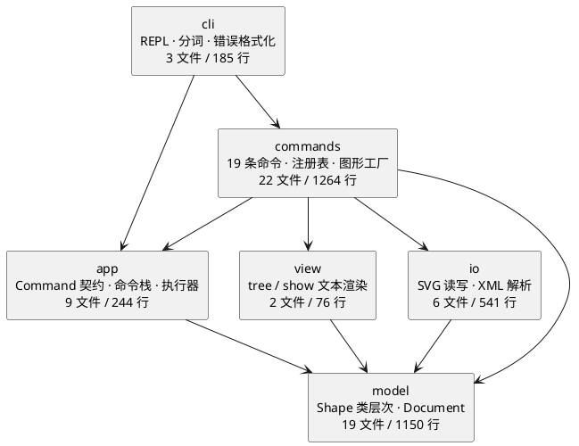
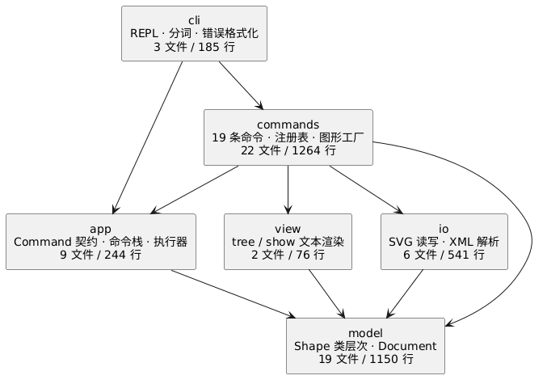

# PJ1 Phase 1：CLI SVG 编辑器

用 TypeScript 写的一个命令行 SVG 编辑器，跑在 Node 上。总共 19 条命令，能建图形、改属性、分组、存读文件，也支持撤销重做。

仓库地址：https://github.com/jcole666/svg-editor （最终版本打在 tag `final` 上）

---

## 一、架构方案

### 1. 模块划分

分成六层，划分依据是依赖方向：上层可以调用下层，下层不认识上层。这样每层职责单一，改动也只会往上影响调用它的模块，不会波及无关部分。

现在一共六个模块，外加一个入口：

| 模块 | 职责 | 文件数 | 行数（整个模块合计） |
|---|---|---|:-:|
| `src/cli/` | REPL 循环、分词、错误格式化、控制台输入输出 | 3 | 185 |
| `src/app/` | 应用层：Command 契约、命令栈、执行器、Session | 9 | 244 |
| `src/commands/` | 19 条命令的具体实现、命令注册表、图形工厂 | 22 | 1264 |
| `src/view/` | tree 和 show 的文本渲染 | 2 | 76 |
| `src/model/` | 图形类层次、Document、领域错误 | 19 | 1150 |
| `src/io/` | SVG 读写、XML 解析 | 6 | 541 |

平均每个文件 50 行左右——任务书要求"一类一文件"，所以文件数量多，但大部分都很短（比如 11 个错误类，每个只有 5 行）。

`src/main.ts` 只有 9 行，负责把 Repl 装配起来启动。

多出来的 `app` 层，是因为"命令对象"要能被撤销栈保存、之后再重新调用。它既不属于 CLI（CLI 只是发起请求），也不属于模型（模型只管数据长什么样）。单独抽出来以后，命令栈、执行器、Session 都有地方放了。

这样划分的直接结果是：加一条新命令只需要动 `commands/` 和注册表；改 tree / show 的显示格式只需要动 `view/`；改 SVG 读写只需要动 `io/`；`model/` 和 `app/` 都不用动。

组件图（PlantUML）：



渲染结果：



### 2. 用了哪些设计模式

#### Command

任务书要求必须用 Command，项目本身也确实需要：要有撤销，就得让"动作"能被存下来再重新执行。一行 `shape.x += dx` 是存不下来的，得是个对象才行。

按课件里的五个角色对一下：

| 课件里的角色 | 我这里的类 |
|---|---|
| Command | `src/app/Command.ts`（`execute(): string[]`） |
| ConcreteCommand | `CreateCommand`、`MoveCommand` 等 10 个可撤销命令 |
| Invoker | `Repl` + `CommandExecutor` |
| Client | `CommandRegistry`（造命令、设接收者） |
| Receiver | `Document` / `Shape` |

约束是命令里不许写业务逻辑，只做参数校验然后转发给 Document。课件里讲到：「命令类里只该有转发这一件事，出现业务判断和状态维护就说明写成了过程式代码。」

#### Composite

`<g>` 是容器，`<rect>` 是叶子。如果每条命令都区分两者，就得写 `switch(tag)`，以后加一种图形还要回头改所有命令。

做法是让 `Group` 也继承 `Shape`。`moveBy` 在叶子上改自己的坐标，在容器上就是遍历子节点递归调用。调用方只写 `shape.moveBy(dx, dy)`，完全不知道手里拿的是哪种。这样"容器与叶子统一操作"就成立了。

#### 没用的模式，以及原因

- Iterator：`tree` 就一个递归遍历，结构也不变，没必要再套一层迭代器。
- Memento：撤销已经用 Command 解决了，再叠一层只会让"每条命令记什么"变模糊。
- Visitor：这个项目"加操作"不频繁，就 tree/show/save 三处，用多态方法够了。

### 3. 依赖方向

规则是：

```text
cli      ->  app, commands
commands ->  app, model, view, io
app      ->  model
view     ->  model
io       ->  model
model    ->  谁也不依赖
```

`main.ts` 是入口，算例外，可以依赖任何模块。

这么定的理由：`model` 是领域核心，不 import 任何上层，所以它最稳、也最好测（30 个接收者层测试完全不碰上层）。`app` 只依赖 model，这样加新命令不用动命令栈。`commands` 是最杂的一层，所有协作都在这里发生，所以依赖最多。`cli` 只依赖 app 和 commands，它不该认识图形。

渲染器放 `view/` 而不是 `cli/`，就是因为 `TreeCommand` 要用它——放 cli 里就变成 commands 反向依赖 cli 了。

这条规则不是靠自觉维持的。我写了 `scripts/check-architecture.mjs`，`npm run check:arch` 会扫一遍真实 import、画成边表对照白名单，出现表外依赖就报错退出。

### 4. 变化点假设

| 可能变的地方 | 留了什么，或者为什么不留 |
|---|---|
| 加新命令（copy、paste 之类） | 加一个类 + 注册表一行，命令栈不用动 |
| 加新图形类型（box、path） | 工厂加个注册 + 一个 Shape 子类。没做插件化，因为任务书 §2.1 说本阶段允许架构层没有插槽，box 按 §4.4 是下一阶段的事，现在提前抽象容易猜错方向 |
| 渲染或序列化格式变化 | 出口只有 `Shape.toSvg()`，改动收在各子类里。`transform` 目前只保存不应用，这是已知缺口，不算预留 |
| tree / show 的显示格式 | 都在 view 两个渲染器里，命令层感觉不到 |
| 撤销粒度改成事务或宏 | `CommandStack` 是唯一入口，宏命令实现 `UndoableCommand` 组合子命令就行 |
| 持久化格式扩展（defs、CSS） | io 完全隔离。目前没支持 defs 和 CDATA，边界写在 `XmlParser` 注释里 |
| 命令分发改成插件注册 | `CommandRegistry` 是唯一的集中点，注释里标了"待重构" |
| 多文档或多视图 | Session 是唯一持有当前文档的地方。单文档已经够用，先不引入 |

---

## 二、和 AI 协作的过程记录

这个项目是我和 Codex（OpenAI 的 AI 编程助手）一起做的。阶段怎么分、每步做到什么算完成由我定，代码和测试主要交给 Codex 写，每写完一步我跑一遍测试、再手工敲几条命令确认，没问题才继续。下面记的是这个过程里发现的问题，主要是 Codex 写的东西哪里不对、我怎么发现的。

### P0 搭骨架

先让 Codex 把 TypeScript 工程和空 REPL 搭起来。跑起来发现敲 `exit` 会崩，报 `ERR_USE_AFTER_CLOSE`。原因是关掉 readline 之后又调了一次 `prompt()`。加个 `stopped` 标志，关了就不再 prompt 才修好。

### P1 图形模型

让 Codex 拆出 `Shape` 抽象基类和六个子类。这里我自己改过一次：它写的 `attributeSummary()` 用两个空格拼几何和 fill，输出成 `h=600  fill=...`，跟任务书 §5.1 的单空格对不上。是单元测试按精确字符串断言才暴露出来的。

还有个规格本身含糊的地方：§6.1 里 line 是带 `stroke=black` 创建的，但 tree 输出里只显示 `(280,130) -> (520,130)`，没有 stroke。我最后定的规则是 tree 只内联 fill，stroke 收到 show 明细里，跟 §5.2 保持一致。这条也写进代码注释了。

### P2 文档模型和只读命令

加 Document 和 init/canvas/tree/show/help。

这段踩了个依赖方向的坑：一开始我把渲染器放在 `src/cli/`，写完发现 `TreeCommand` 要 import 它，于是 commands 反向依赖了 cli。后来新建 `src/view/` 才顺过来。

还有 tree 的对齐规则。任务书示例里各列宽度其实不一致（外层大概 15 列，内层 11 列），推不出唯一规则。我定了"同一组兄弟按最宽 label 加 2 空格对齐"，然后用测试把输出逐字锁住。不然每次 label 长度一变，diff 全是空白变动。

### P3 create 和图形工厂

这段有个真 bug，是测试抓到的。

分词器一开始我把 `#` 当注释处理，结果 `create rect start 120 100 160 60 #4a90d9 in node1` 里，颜色值 `#4a90d9` 连同后面的 `in node1` 全被吞了，图形挂到了画布根上。回去翻任务书 §2 才发现原文是「`#` 开头为注释」，指的是整行，不是我理解的"行内注释"。改成行首判断后又补了 7 个分词器测试（颜色值、引号里的 `#`、空行）。

`in` 子句也有个歧义：`create text t1 0 0 "in"` 里内容是 "in"，如果按"参数里包含 in 就拆"会误判。所以改成看位置，倒数第二个 token 正好是 `in` 才算子句。

### P4 编辑命令

这一阶段没什么争议，四条命令都只是校验参数然后转发。

倒是 `move` 的反馈格式要自己定：任务书里叶子是 `moved to (130,100)`，容器是 `moved by (0,100)`。我在 Shape 上加了 `referencePoint()`，叶子返回参照点，容器返回 null，一个方法就同时满足了两种输出。

### P5 撤销重做

这是花时间最多的一段，也是我先做错再改对的一次。

第一版用的是快照：每次编辑前把整个文档深拷贝一份存着，撤销就整份换回去。十几分钟写完，98 个测试也都过。但测了一下代价：

| 图形数 | 每次编辑的快照耗时 | 克隆对象数 |
|---|---|---|
| 1000 | 0.156 ms | 1001 |
| 5000 | 0.651 ms | 5001 |

更要命的是它给不出任务书 §6 要求的那种反馈：

```
svg> undo
circle#c1 moved back to (100,100)
```

快照法只知道"整份文档变回某个样子了"，不知道是哪条命令被撤销，这句话根本印不出来。课件命令模式那讲也提到过：AI 可能直接给你快照方案，要在提示词里说清要哪一种。

所以推倒重写成 Command 模式：`UndoableCommand` 在 `execute()` 之外加 `undo()`，`CommandStack` 用两个栈管着，执行时清空 redo 栈，撤销时把命令转到 redo 栈，重做就重新 `execute()`。

每条命令记的东西不一样，这块比想象中费脑子：

- create 记住创建出来的对象引用，撤销就是删掉它
- delete 要记 `{ shape, parent, index }`。只记对象不够——得放回原来的父容器、原来那个位置，不然兄弟顺序变了，z-order 就错了
- move 和 scale 记被改动那棵子树的几何值
- set 除了记旧值，还要记"原来有没有这个属性"。比如原本没有 fill，`set r1 fill red` 撤销时要整个删掉，不能设成空字符串

move/scale 这里我一开始想用反向运算（`moveBy(-dx,-dy)`、`scaleBy(1/f)`），试了一下发现浮点不保证可逆，10 乘 3 再除 3 会得到 9.999999999999998。后来改成记旧几何值再写回去，还专门写了条测试守着。

改完之后同样的操作：

| 图形数 | 快照法 | Command 法 | 快了 |
|---|---|---|---|
| 1000 | 0.156 ms | 0.0039 ms | 40 倍 |
| 5000 | 0.651 ms | 0.0006 ms | 1124 倍 |

差距原因很直白：快照的代价跟整份文档规模成正比，命令只跟"这次改了多少"成正比。

这次重构没动 `Repl`，也没动 `CommandRegistry`，只改了 `app/` 内部和 5 个命令类。界限划清楚之后，改动范围确实关得住。

### P6 容器命令

group / ungroup / addto / front / back 功能不难，但容易把树改坏。

第一，得防环。`group bad c1 markers`（markers 里已经装着 c1）如果不拦，就会造出"自己包含自己"的树，tree 直接无限递归。校验要放在任何改动之前。

第二，一个设计上的修正。我原来只给 Document 提供了 `add` / `insert` / `remove`，它们都会登记或注销 id 索引。写 `ungroup` 的 undo 时就报 `id already exists`——因为被提升到父级的子节点一直还在索引里，再 insert 一次就重复登记了。这才意识到"新建"和"移动"是两件事，于是又加了 `detach` / `reparent`，只改结构不动索引。

第三，undo 要原位恢复。group 的 undo 得按原下标升序放回，降序插会把顺序插反；front / back 的 undo 要恢复原下标。兄弟顺序不是细节，它本身就是 z-order。

另外任务书 §4.2 规定画布根级的容器不能 ungroup，所以 §6.1 那个根级的 `g#flowchart` 实际上解不开。我照规格实现了，也在这里记一笔。

### P7 读写 SVG

为了让程序真的能产出文件，得自己写个 XML 解析器。没引第三方库，因为要处理的语法子集不大（声明、注释、自闭合、嵌套、单双引号属性、实体），自己写两百行比较可控；不支持的 CDATA 和 DTD 写在注释里了。

自动补 id 这块差点写错。如果边解析边分配，会出现"先给匿名 `<rect>` 分了 rect1，后面又读到一个显式 `id="rect1"`"的撞车。所以改成两遍：第一遍收集文件里所有显式 id，第二遍才分配并跳过它们。

未知属性（font-size、text-anchor 这些）我用 `restoreAttribute` 原样留着，save 的时候不丢。这样读一个带字号的 SVG、改个坐标、存回去，字号还在。`transform` 目前只保留不应用，这是已知限制。

### P8 错误文案

功能齐了之后，专门拿一个阶段把 §4.2 那张表里的错误文案逐条对上。做法是写一张对照表测试，期望值带上 `error: ` 前缀，就是用户在终端里真正看到的那一行。

为了这个，我把 Repl 里自己拼前缀的代码抽成了 `ErrorFormatter`，让测试和线上走同一个格式化路径。不然很容易出现"测试断言 message、线上打印多一层前缀"的错位。

表里第 6 条 `cannot ungroup composite shape` 这段实现不了，因为 box 是下一阶段的类型，现在 `create box` 会先报 unknown shape type。我写了条测试把这个现状固定下来，也在这里说明一下，免得看起来像漏掉了。

### P9 测试分层

前面都是写到哪测到哪，这一段按课件 TDD 的四层策略回头盘点，发现端到端层和调用者层基本是空的。

端到端为空，根子不是没写测试，是 `Repl` 写成了不可测：输入输出硬编码 `process.stdin` 和 `console.log`。改成构造参数接收 input/output 流、`start()` 返回 Promise 之后，就能用内存流跑一次完整会话了。课件说"可测试的两个条件：控制输入、观测输出"，这次算是有体会——不可测往往是设计的问题。

调用者层用假命令测：`FakeCommand` 只往数组里记一笔，不碰真实图形，专门验证命令栈的进出栈顺序、redo 清空、io 后禁止这些编排行为。

还顺手改了条会过期的断言。P2 时我写过 `expect(registry.get('create')).toBeUndefined()`，意思是"create 还没实现"，到 P3 实现完它就红了。教训是断言要表达稳定的契约，别表达当前进度。

### P10 文档和自查

写文档的时候我想验证依赖规则有没有真的做到，就写了个脚本扫 import。第一次跑出来：

```
app -> commands   2 处
commands -> app  29 处
```

`app` 里的 `CommandExecutor` 和 `UndoableCommand` 引用了 `commands/Command.ts` 里的命令契约，跟 `commands -> app` 构成了模块级循环。平时没出过 bug，因为这两处都是 `import type`，编译就擦掉了。但类型层面的循环会把真实耦合藏起来，跟文档里写的单向依赖不符。

改法是把命令契约（`Command` / `CommandKind`）和 `UndoableCommand` 挪到 `src/app/`，命令层从 app 取。改完脚本输出"无表外依赖"。

后来我把这个检查固化成了 `npm run check:arch`，跟 typecheck、test、build 一起进了提交前的清单。

---

### P11 交叉审查与修复

写完文档之后，我又让另一个 AI 按任务书把项目完整审了一遍，它报了两个严重问题。我没直接照改，先自己验证。

第一个：`group` 不检查重复成员。敲 `group g1 r1 r1` 会把同一个对象加进容器两次，`tree` 打印两行 `rect#r1`，`save` 写出两个相同 id 的 `<rect>`，违反了 §2 的「id 强制唯一」。

第二个更严重：`ungroup` 撤销时用 `new Group(...)` 重建了一个容器。先前命令（`delete`、`front`、`addto`）的撤销里存着"父容器"的引用，对象一换，那些引用就指向了已经脱离文档树的孤儿节点。表现是图形从 `tree` 里消失，但 `show` 还能查到——不会报错，只是数据悄悄坏了。

验证办法是先写回归测试，再把旧代码 stash 起来跑一遍：4 条失败；恢复修复后 6 条全过。确认不是误报，才开始改。

顺带按它的建议，把散落在 8 个文件里的 11 处 `instanceof Group` 收敛成 `Shape` 上的多态查询（`isContainer()` / `childShapes()` / `contains()`），对应 §2.1 禁止类型分派那一条。

测试 207 → 213。

---

## 三、一致性自查

**问题一：实际目录和方案是否一致？**

一致。六个模块目录都在，职责跟文档里写的一样，没有遗留的临时目录。

有一处修订：`Command.ts` 本来在 `src/commands/`，P10 自查时挪到了 `src/app/`。原因见问题二。

**问题二：依赖方向的规则有没有被违反？**

违反过，已经修了。

就是上面 P10 说的那次：脚本第一次扫出来 `app -> commands` 有 2 处，跟 `commands -> app` 形成循环。处理方式是把命令契约上移到 `app/`。现在 `npm run check:arch` 输出"依赖方向检查通过：无表外依赖"。

这 2 处都是 `import type`，运行时确实没出过问题。但我还是改了，因为文档里写的规则如果代码没做到，那文档就是假的。

---

## 四、功能完整性和质量保证手段

### 1. 功能是否完整

公告里列的能力，对应的命令如下：

| 要求 | 命令 |
|---|---|
| 创建 | `init`、`create`（rect / circle / ellipse / line / text / g，支持 `in` 子句） |
| 读取 | `read` |
| 保存 | `save`（无参数时存回读入的路径） |
| 移动 | `move` |
| 缩放 | `scale` |
| 分组 | `group`、`ungroup`、`addto` |
| 删除 | `delete` |
| 属性修改 | `set` |
| 结构查看 | `tree`、`show` |
| 撤销重做 | `undo`、`redo` |
| 其他 | `canvas`（画布尺寸）、`front` / `back`（层级）、`help` |

一共 19 条，跟任务书 §3 的命令表一一对应。有条测试专门断言注册表"不缺、不多"，以后谁加了命令忘了登记会先红。

没做的是 §4.4 的 `box` 复合图形和 ShapeProvider 插件机制，任务书写明属于下一阶段。

### 2. 测试怎么分的

按课件的四层策略：

| 层 | 测什么 | 数量 |
|---|---|---|
| 接收者层 | 图形几何、Document 的索引和父子关系 | 30 |
| 命令层 | 每条命令执行后的状态、undo 是否精确还原、错误文案 | 116 |
| 调用者层 | 命令栈的编排（用假命令，不碰真实图形） | 9 |
| 端到端 | 走真实 Repl 的完整链路（内存流替换 stdio） | 8 |
| 支撑层 | 分词、文本渲染、XML 解析 | 28 |
| 规格一致性 | 注册表是否恰好等于 §3 的 19 条命令 | 22 |

加起来 213 个，`npm test` 全绿。

分层的好处是排查方向明确：命令层红了先看接收者层是不是本来就坏了，范围能快速缩小。端到端只验链路通不通，不重复验业务细节，不然改一处要改三个地方。

### 3. 命令覆盖情况

| 命令 | 正常路径 | 出错路径 | undo |
|---|:-:|:-:|:-:|
| init / read / save / canvas | 有 | 有 | —（文档类，执行后禁止 undo） |
| create | 有 | 有 | 有 |
| delete | 有 | 有 | 有 |
| move | 有 | 有 | 有 |
| scale | 有 | 有 | 有 |
| set | 有 | 有 | 有 |
| group | 有 | 有 | 有 |
| ungroup | 有 | 有 | 有 |
| addto | 有 | 有 | 有 |
| front / back | 有 | 有 | 有 |
| tree / show / help | 有 | 有 | —（显示类，不进栈） |
| undo / redo | 有 | 有 | —（自身不进栈） |

### 4. §4.2 错误文案

| 场景 | 输出 | 状态 |
|---|---|---|
| id 已存在 | `error: id already exists: r1` | 已实现 |
| id 不存在 | `error: no such shape: r9` | 已实现 |
| in 目标不存在 | `error: no such container: node9` | 已实现 |
| in 目标不是容器 | `error: not a container: start` | 已实现 |
| 未注册类型 | `error: unknown shape type: hexagon (is the plugin loaded?)` | 已实现 |
| ungroup 复合图形 | `error: cannot ungroup composite shape: n1` | 下一阶段 |
| group 含容器与其子孙 | `error: cannot group a container into its own descendant: markers` | 已实现 |
| ungroup 根级容器 | `error: cannot ungroup top-level container: scene` | 已实现 |
| scale 非正数 | `error: scale factor must be positive` | 已实现 |
| 文件读不到 | `error: cannot read file: a.svg` | 已实现 |
| 文件写不了 | `error: cannot write file: a.svg` | 已实现 |
| 没有文档 | `error: no document. use 'init' or 'read' first` | 已实现 |

12 条里对上 11 条，剩下那条按规格属于下一阶段。

### 5. 怎么跑

```powershell
npm install
npm test           # 213 个测试
npm run typecheck  # 严格模式类型检查
npm run check:arch # 依赖方向检查
npm run build      # 编译到 dist/
npm run cli        # 启动编辑器
```
