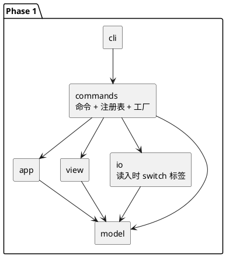
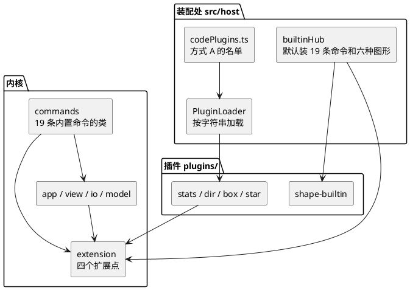

# PJ1 Phase 2：插件实践和插件式重构

Phase 1 的命令行编辑器还在这个仓库里，tag `final` 没动。这一阶段做了两件事：一个 VSCode 扩展，以及把 CLI 改成可以挂插件。原有 19 条命令和六种图形的行为没有改，不装新插件时 `tree` 的输出和以前逐字节一样。

第一阶段的说明挪到了 [phase1.md](phase1.md)。

仓库：https://github.com/jcole666/svg-editor  
本阶段 tag：`p2`

---

## 一、VSCode 扩展

代码在 `vscode/svg-outline`。它不进 CLI 的行数统计。

### 怎么跑

```powershell
cd vscode/svg-outline
npm install
npm run compile
```

用 VSCode 打开 `vscode/svg-outline` 这个目录，按 F5。扩展开发宿主里打开 `fixtures`，`example.svg` 右边会出现 `[]`，`plain.txt` 和文件夹没有。打开 `example.svg`，左下角大纲能看到 `svg`、`g#flow`、`rect#start`，没有 id 的文字只显示 `text`。点 `rect#start` 会跳到对应那一行。把 XML 写成一半时大纲清空，扩展不会崩。

标记截图在 `docs/images/vscode-svg-badge.png`，大纲截图在 `docs/images/vscode-svg-outline.png`。资源管理器里只有 `example.svg` 带 `[]`，`plain.txt` 没有。大纲是 `svg`、`g#flow`、`rect#start`、`g#nested`、`text`，点 `rect#start` 会落到第 3 行。

### VSCode 和插件各管什么

资源管理器和大纲视图是 VSCode 自己的。插件做的事只有两件：在 `activate` 里调用 `registerFileDecorationProvider` 和 `registerDocumentSymbolProvider`。之后什么时候问「这个文件要不要徽章」「这份文档的符号树是什么」，都是 VSCode 来调用我注册的对象。插件不自己画树，也不改文件名或文件内容。

文件装饰和课件里的 Decorator 不是一回事。Decorator 是包住一个已经有的对象，对外还是原来的接口，只是多了一层行为。这里没有一个 File 对象被包起来。VSCode 规定了 `FileDecorationProvider` 这个接口，插件把「是不是 svg」翻译成一个 `FileDecoration`。这个角色更接近适配器：VSCode 要的是它自己的接口，svg 文件只是路径，两边对不上，插件在中间做转换。和经典适配器的差别是，被适配的那一方并没有一个现成的类，只是文件名和 `stat` 的结果。

大纲同理。`DocumentSymbolProvider` 是 VSCode 的端口，`parseOutline` 只负责从文本算出名字和行列号。

### 能不能复用 Phase 1 的解析器

文件标记完全用不到解析器，看后缀就够了。

大纲想复用 `XmlParser` 和 `Shape`，试下来不行。CLI 的解析器解析失败会抛错，也不记录每个标签在第几行。大纲在用户正打字时经常遇到不完整的 XML，这时要返回空列表，不能把异常抛出去。另外扩展跑在 VSCode 的进程里，没必要把 `Document`、命令栈这些拖进来。所以 `vscode/svg-outline/src/outline.ts` 是单独写的一个小解析器，只认标签、属性和嵌套。

测试在 `test/vscode/outline.test.ts`，覆盖嵌套、无 id、改完文本后行号变化、半截 XML。

---

## 二、CLI 现在怎么分成几块

Phase 1 是六层，命令和图形都写死在 `CommandRegistry` 和 `ShapeFactory` 里。那两处当时就标了「等插件化再改」。这一阶段把它们拆开了。





依赖方向用 `npm run check:arch` 扫真实 import。内核可以依赖扩展点接口，不能依赖某个插件。插件可以依赖 `model`、`app`、`extension`、`io`，以及 `UsageError`。不能依赖 `host`、`cli`，也不能 import 另一个插件。`src/host` 和 `src/main.ts` 是组合根，允许认识具体插件。

不带任何参数启动时，只装内置的 19 条命令和六种图形。`stats`、`dir`、`box`、树标签都不会出现，Phase 1 的测试仍然是原来的断言。

---

## 三、扩展点清单

四个接口都在 `src/extension/`。插件通过 `PluginContext` 登记，内核其它地方只拿注册表。

| 接口 | 干什么 | 内核在哪调用 | 现在的实现 | 不装时 | 违反契约时 |
|---|---|---|---|---|---|
| `ShapeProvider` | 一种图形的创建和读回 | `CreateCommand.execute` 调 `ShapeCatalog.create`；`SvgReader.buildShape` 调 `ShapeCatalog.readerFor` 再调 `read` | `plugins/shape-builtin` 的 rect / circle / ellipse / line / text / g，外加 `BoxProvider` | `create` 不认识的类型报 `unknown shape type`；读入时没有对应标签就跳过。`data-kind` 没有插件认领时按普通标签读 | 类型名或标签重复时 `DuplicateRegistrationError`，加载器打印 `error: duplicate registration: shapes/<name>` 并撤回这个插件 |
| `CommandSpec` | 一条命令的名字、help 和工厂 | `Repl.handleLine` 调 `CommandRegistry.get` | 19 条内置命令在 `registerBuiltinCommands` 里登记；`stats`、`dir` 由各自插件登记 | 未登记的名字由 `Repl.handleLine` 打印 `error: unknown command: <name>` | 命令名重复同样走 `duplicate registration: commands/<name>` |
| `TreeDecorator` | 结构树每一行行尾的标签 | `TreeCommand.execute` 把 `DecoratorRegistry.all()` 传给 `TreeRenderer`；真正拼接在 `TreeRenderer.finish` | `BoxLabel` 写 `(box)`，`ModifiedStar` 写 `*` | 装饰器数组为空时 `finish` 原样返回，不加空格 | 同名装饰器重复登记会被拒绝并撤回 |
| `AttributeHandler` | 对某类图形设置某个属性时具体改什么 | `SetCommand.execute` 调 `AttributeRegistry.matching` | `BoxAttributeHandler`，注册名 `box-attributes` | 没有命中时走 Phase 1 的 `Shape.setAttr`。白名单外仍是 `unknown attribute` | 两个处理器同时 `handles` 返回 true：`ConflictingAttributeHandlerError`，文案 `conflicting attribute handlers: <attr>`，不执行任何一个 |

内置图形也走 `ShapeProvider`，只是默认装配一定会装上，不写进 `plugins.config.json`。这样禁用「可选插件」时六种图形还在。

---

## 四、两种装配

两条路最后都进 `PluginLoader.loadSpecifier`。差别只在谁决定加载哪一个模块。

**方式 A，改代码。** `src/host/codePlugins.ts` 里有一个数组，`activateCodedPlugins` 按顺序调用加载器。新增插件要改这一处并重新构建。

```powershell
npm run cli -- --code-plugins
```

**方式 B，改配置。** 仓库根的 `plugins.config.json`。已有的 ts 源码不用改。

```powershell
npm run cli -- --config plugins.config.json
```

配置的形状：

```json
{
  "plugins": [
    { "module": "./plugins/command-stats" },
    { "module": "./plugins/command-dir", "options": { "cwd": "D:/tmp/sample" } },
    { "module": "@svgframe/plugin-shape-box" },
    { "module": "./plugins/tree-modified-star", "enabled": false }
  ]
}
```

- 按数组顺序加载。`enabled: false` 整项跳过，路径不存在也不报。
- 以 `./` 开头的路径相对配置文件所在目录，不是进程的 cwd。
- 包名交给 Node 的 `require.resolve`，加载器里没有插件名对照表。
- `options` 原样传给 `activate(ctx, options)`。`dir` 如果收到 `options.cwd` 就列那个目录，否则用 `process.cwd()`。
- 每个插件的 `package.json` 用 `contributes` 声明 `shapes` / `commands` / `decorators` / `attributes`。缺省当空数组。加载成功后比较声明和实际登记的名字集合，顺序无关。

失败时打印一行，进程继续，已经成功的插件保留：

| 情况 | 输出 |
|---|---|
| 模块找不到 | `error: plugin not found: <module>` |
| 没有默认导出 | `error: plugin has no default export: <module>` |
| 清单和实际登记不一致 | `error: plugin manifest mismatch: <name> (declared: …, registered: …)` |
| `activate` 抛错，或模块找到了但求值失败 | `error: plugin failed to activate: <name> (<reason>)` |
| 注册名重复 | `error: duplicate registration: <category>/<name>` |
| 配置本身不是合法结构 | `error: invalid plugin config`，然后只用内置能力 |

清单不一致、激活失败、重复注册，都会把这个插件已经登记的东西撤掉。比较发生在 `activate` 返回之后，见 ADR 4。

方式 A 的证据是 `819e40b`（登记 box）。`git diff --name-status 819e40b^ 819e40b` 只有 `plugins/shape-box/` 和 `src/host/codePlugins.ts`。下面这条对内核、加载器和已经存在的插件是空的：

```powershell
git diff 819e40b^ 819e40b -- src/commands src/model src/app src/view src/io src/cli src/extension plugins/shape-builtin plugins/command-stats plugins/command-dir
```

`stats`（`eb9398c`）、`dir`（`799f938`）、星号（`5d73102`）同样只动了自己的目录和 `codePlugins.ts`。

方式 B 在分支 `demo/box-config`，提交 `0ff270a`，父提交是扩展点那次 `b46d9fa`。`git diff --name-status b46d9fa 0ff270a` 只有 `plugins/shape-box/` 和一份只列 box 的 `plugins.config.json`。主线上的配置清单是另一次提交 `c0723e8`，列了四个可选插件。`test/plugins/stats.test.ts` 和 `test/plugins/dir.test.ts` 对同一输入比较了两种装配的输出。

---

## 五、dir 和适配器

`dir` 不接收参数，列出的是进程当前工作目录的直接子项，不是当前 svg 所在的目录。`read` / `save` 不改变它。隐藏文件要列出，不列 `.` 和 `..`。目录在前，普通文件在后，符号链接单独一组，各组按名字的码点升序。标记和名字之间是两个空格，所以是 `[DIR]  docs`、`[FILE]  demo.svg`。空目录打印 `(empty directory)`。读失败打印 `error: cannot read directory: <path>`，然后还能继续敲别的命令。

没执行 `init` 也可以用。成功或失败都不改文档，不进 undo 栈。

符号链接用 `lstat` 那种「不跟随」的判断，显示成 `[LINK]`，不走进去看目标是文件还是目录。

对应适配器的角色：

| 角色 | 类 |
|---|---|
| Target，命令希望看到的目录接口 | `DirectoryListing` |
| Adapter | `NodeFsDirectoryListing`，把 `fs.readdirSync` 的 `Dirent` 收成 `{ name, kind }` |
| Adaptee | `node:fs` |
| Client | `DirCommand`，只依赖 `DirectoryListing` |

测试替身直接实现 `DirectoryListing`。真实目录的测试用临时文件夹加上 `NodeFsDirectoryListing`。两种装配传进同一个 `DirCommand` 和同一份 `options.cwd`，输出逐字节相同。

---

## 六、box、属性和树标签

`create box n1 120 100 160 60 "开始"` 会做出 `g` + `rect#n1-rect` + `text#n1-label`。矩形默认填充 `#4a90d9`，文字放在 `(x+20, y+h/2+5)`，160×60 的框就是 `(140,135)`，和 §6.1 版本 B 对得上。

命令反馈用 `box#n1`，树的标题用 `g#n1`，行尾由 `BoxLabel` 追加 `(box)`。这两件事分开，是因为树的标签要求渲染器不认识 box。

`set n1 fill #f5a623` 改内部矩形，`set n1 label "..."` 改内部文字。各是一次 undo。`ungroup` 报 `cannot ungroup composite shape`。`delete` / `addto` / `group` 想把 `n1-rect` 或 `n1-label` 带走时拒绝，文案是 `cannot modify composite shape structure: n1`。`front` / `back` 只是在同一个父节点里换位置，仍然允许。

序列化是 `<g id="n1" data-kind="box">`。装了插件就还原成 box；没装就当普通 `g`，`data-kind` 当作普通属性留下来。缺了矩形或文字、或者类型不对，整份 `read` 失败，原来的文档不动。文件里出现重复的显式 id 也拒绝整份读入，不靠再分配一个 id 把冲突藏起来。

`stats` 从画布子节点深度优先。叶子按类型计数，顺序是第一次遇到的顺序。普通 `g` 和 `box` 只算 containers，根 svg 不算。box 里面的矩形和文字照常算进 total。不进 undo 栈。

`modified-star` 的状态在 `ModifiedStar` 的字段里，不是模块级变量。规则见 ADR 3。它和 `(box)` 互不 import。注册顺序是先 box 再 star，所以同一行先 `(box)` 再 `*`。

---

## 七、ADR

### 1. 属性处理器：冲突就拒绝，一次 set 用一份子树快照

处理器要能改子部件，还要保证一次 `set` 是一个 undo，中途抛错不能把文档改脏。

我让 `handles` 只做判断。`SetCommand.execute` 收集所有返回 true 的处理器。零个，走原来的白名单。一个，在调用 `apply` 之前用 `AttributeSnapshot` 记下这棵子树每个节点的几何和 presentation。`apply` 抛错就把快照写回去，异常继续往外抛，`CommandStack` 只有在 `execute` 正常返回后才入栈，所以 undo 历史不变。成功的话，这份快照留给 `undo`，处理器只负责两句反馈。

两个都命中时直接报错，不按优先级挑一个，也不串起来执行。优先级以后若要加，可以再改这个决定；现在没有明确的先后，偷偷选一个会盖掉另一个。

没把 `label` 放进内核白名单。普通矩形执行 `set r1 label x` 仍然是 `unknown attribute`。

### 2. box 读回来：缺零件就拒绝，没装插件才降级

缺 `n1-rect` 或 `n1-label`，或者 id 对了但类型不对，有两种做法：整份文件拒绝，或者警告后当成普通 `g`。我选拒绝。降级会留下一个不完整的 box，后面的 `set fill` 不知道该改谁。没装插件时的降级是另一回事，那时根本没有 box 这个类型，按 `g` 读是任务书要求的。

重复 id 不能靠降级消掉，`SvgReader.ensureId` 遇到已经用过的显式 id 会抛 `DuplicateIdError`，`read` 不会替换当前文档。

子部件 id 固定是 `<id>-rect` 和 `<id>-label`。`document.add` 会先把整棵子树的 id 检查一遍，再登记。冲突时容器和子部件都不会留下。

### 3. 星号按「和上次保存的内容是否一致」，祖先也标

另一种做法是「执行过编辑命令就打星，undo 也不摘」。那样 undo 回到保存点以后星号还在，和「没保存的修改」对不上。我改成在 `init` / `read` / 成功的 `save` 时记一份基线（每个 id 一个 `stateKey`，外加画布尺寸）。渲染时再比。undo 回到那份内容，星号自己消失。

新建的图形不在基线里，所以一创建就有星号。子节点变了，父节点那一行也标。只标子节点的话，折叠着看容器看不出有没有没保存的修改。

多个标签的拼接顺序就是注册顺序，不在渲染器里写死谁先谁后。

### 4. 清单在 activate 成功之后对，对不上就整单撤回

也可以在登记每个扩展时立刻和清单比对。那样插件得按声明的顺序登记，多登记一个马上失败，测试也不好写。我让插件先正常 `activate`，登记进一张暂存表。返回之后再比名字集合。不一致、或者 `activate` 中途抛错，就把这张暂存表里的登记全部撤掉，然后继续下一个插件。

配置文件本身解析失败或结构不对，不加载其中任何一项，内置命令和六种图形照常可用。

---

## 八、和 AI 一起改的地方

这一阶段用 Opus 5.5 改代码。阶段划分和验收标准是我定的，生成出来的东西我用原来的 213 个测试，加上新写的插件测试，对过以后才留。下面是对过、并且改过的几处。

树的标题。第一版让 box 的 `label()` 直接返回 `box#n1`，`tree` 就变成 `box#n1 (box)`。任务书版本 B 的树是 `g#n1 (box)`，移动的反馈才是 `box#n2 moved by`。所以树用单独的 `treeLabel()`，命令反馈继续用 `label()`。行尾的 `(box)` 只由装饰器追加，渲染器不写这个词。

`set` 的撤销。助手一开始倾向让处理器返回一个自己的 undo 函数。box 的 fill 只改一个子节点，这样写得通，但「改到一半抛错」测不过：抛错前矩形的 fill 已经变了，undo 栈又还没推进去。改成执行前拍子树快照，失败写回，成功也用同一份快照做 undo。Phase 1 那种「只记一个属性旧值」的路径还留着，没有处理器命中时走原来的代码。

`dir` 的空格。示例里 `[DIR]` 和 `[FILE]` 看起来像在对齐名字。正文写的是标记后面两个空格。我按正文做，两组都是两个空格，不按标签宽度补齐。测试把这个字符串锁死了。

加载器的相对路径。测试把配置写到系统临时目录，插件却用 `./plugins/ok` 这种相对路径，结果报找不到。相对路径必须相对配置文件所在目录。正式的 `plugins.config.json` 放在仓库根，`./plugins/command-stats` 就是对的。

还有一处是读入重复 id。Phase 1 遇到撞车的显式 id 会再分配一个新的。box 的要求是重复 id 必须拒绝整份文件，不能靠改名混过去。`ensureId` 现在直接抛错。原来的「自动补 id 避开已经声明的 id」还在，只是两个元素写了同一个 id 时不再沉默。

---

## 九、怎么确认没改坏

```powershell
npm install
npm test
npm run typecheck
npm run check:arch
npm run build
npm run metrics
```

`npm test` 包含原来的 Phase 1 测试，以及加载器、`stats`、`dir`、`box`、星号、大纲的测试。

不装新插件：

```powershell
npm run cli
```

装上这一阶段的插件，两种方式：

```powershell
npm run cli -- --code-plugins
npm run cli -- --config plugins.config.json
```

回放用的命令在 `doc/transcript/`。`cli-1.txt` 不要装树标签，否则 `tree` 会多出星号。`cli-box.txt` 需要 box。`dir` 不要拿仓库根目录对输出，文件一变结果就变，测试里用的是临时目录。

规模数字由 `scripts/metrics.mjs` 对比 tag `final` 和当前 `HEAD` 写到 `docs/metrics/report.md`。VSCode 扩展单独一列。相对 `final`：内核多 173 行、圈复杂度多 51；装配处多 524 行；插件 662 行；扩展 255 行。这四行是脚本写出来的，我抄过来方便看。
